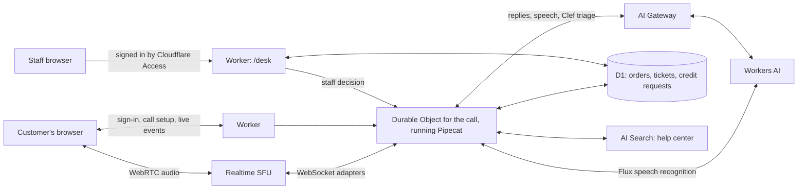

# Acme support voice agent

> Example status: **Experimental**

Matt is a voice support agent for Acme Corp, a made-up store that sells gadgets for everyday adventures. You sign in, start a call in your browser, and talk to him about your orders. He can look up an order, answer policy questions from Acme's help center, cancel an order that hasn't shipped, open a support ticket, and ask someone on the support team to approve store credit while you're still on the call.

This repository is a template for building a voice agent on Cloudflare. The voice loop (listen, think, speak) runs in a Durable Object on Workers, and everything around it, from the order database to the staff desk, also runs on Cloudflare.

## What each piece does

| Piece                                                                                                                           | What it does here                                                                                                                                                                                                                             |
| ------------------------------------------------------------------------------------------------------------------------------- | --------------------------------------------------------------------------------------------------------------------------------------------------------------------------------------------------------------------------------------------- |
| [Realtime SFU](https://developers.cloudflare.com/realtime/sfu/)                                                                 | Carries audio between the caller's browser and the agent. An SFU (Selective Forwarding Unit) is a media server that passes audio streams along without changing them.                                                                         |
| [Workers](https://developers.cloudflare.com/workers/) and [Durable Objects](https://developers.cloudflare.com/durable-objects/) | Each call gets its own Durable Object, a small server with its own memory and storage that every request about that call reaches. [Pipecat](https://docs.pipecat.ai/), an open source voice agent framework, runs the conversation inside it. |
| [Workers AI](https://developers.cloudflare.com/workers-ai/)                                                                     | Flux turns speech into text and decides when the caller has finished talking. A DeepSeek language model writes Matt's replies, and Aura turns them into speech.                                                                               |
| [D1](https://developers.cloudflare.com/d1/)                                                                                     | Cloudflare's SQL database. It holds customers, orders, tickets, and credit requests.                                                                                                                                                          |
| [AI Search](https://developers.cloudflare.com/ai-search/)                                                                       | Searches Acme's eight help center articles. Matt is told to answer policy questions only from what it returns.                                                                                                                                |
| [Sign in with Cloudflare](https://developers.cloudflare.com/fundamentals/oauth/create-an-oauth-client/)                         | Customers sign in with their Cloudflare account, and the server turns each login into an Acme customer account.                                                                                                                               |
| Clef                                                                                                                            | A Workers AI model that answers multiple-choice, scoring, and yes-or-no questions. After Matt opens a ticket, Clef picks the team, scores the urgency, and estimates whether the customer asked for a person.                                 |
| [AI Gateway](https://developers.cloudflare.com/ai-gateway/)                                                                     | Labels each language model, text-to-speech, and Clef request with the customer and call it belongs to, so you can filter logs by customer and give each customer a spending limit.                                                            |
| [Cloudflare Access](https://developers.cloudflare.com/cloudflare-one/access-controls/)                                          | Signs staff in to the desk at `/desk`, where a person approves or declines the credit Matt asks for.                                                                                                                                          |

## Architecture



When the caller speaks, the browser sends audio over WebRTC, the browser's built-in standard for live audio and video, to Realtime. Realtime forwards it to the call's Durable Object as raw audio over a WebSocket. Pipecat passes the audio through speech-to-text, the language model, and text-to-speech, and the reply travels back the same way. Meanwhile the page keeps asking the call for new events, such as transcripts and tool results, and draws the conversation from them. [How it works](docs/how-it-works.md) follows one call through the code.

## What Matt can do

Matt has five tools. A tool is a function in this repository that the language model can ask to run. The model picks the tool and fills in details such as an order number. The code checks those details, runs the tool, and sends the result back to the model, which then writes what Matt says.

| Tool                   | What it does                                                          | Limits                                                                                                                                 |
| ---------------------- | --------------------------------------------------------------------- | -------------------------------------------------------------------------------------------------------------------------------------- |
| `get_account`          | Reads the caller's orders, store credit, tickets, and credit requests | Only the signed-in customer's account.                                                                                                 |
| `search_help_center`   | Searches the help center with AI Search                               | Returns the top three excerpts.                                                                                                        |
| `cancel_order`         | Cancels an order                                                      | Only orders that haven't shipped. Matt reads the order back first, and the cancel runs only if the caller says yes on their next turn. |
| `open_ticket`          | Opens a ticket for a person on the support team                       | Clef then routes it in the background.                                                                                                 |
| `request_store_credit` | Asks the support team to approve store credit                         | Only delivered or returned orders, and never more than the order total. The credit stays pending until someone decides on the desk.    |

The model chooses which order to look up, but the customer comes from the sign-in, so the model can't reach another customer's account. If a tool fails, the error goes back to the model as the result, so Matt can tell the caller what went wrong. The model can ask for at most five tool calls in one response, and each tool call times out after 10 seconds.

## Preview the interface

With the Node.js version in [.nvmrc](.nvmrc):

```sh
npm ci
npm run dev
```

Open `http://127.0.0.1:5173` for the customer page, or `http://127.0.0.1:5173/desk` for the staff desk. The preview uses sample data and needs no credentials or microphone. To make real calls, follow the [deployment guide](docs/deployment.md). You need Workers Paid, a Realtime SFU app, and Zero Trust for the staff desk.

## Run the demo

Use a headset if you can. It keeps Matt's voice out of your microphone, so he doesn't hear himself and stop talking.

Keep the staff desk open in another window to watch tickets and credit requests arrive, and select **Reset demo data** on the desk before you start.

1. Select **Sign in with Cloudflare**. The page shows the email you're signed in as. Your account starts with four orders: a Self-Folding Umbrella delivered two days ago, Spring-Loaded Sneakers with no carrier scan for five days, a Jet-Powered Pogo Stick, and an Instant Tunnel Kit that hasn't shipped.
2. Start a call and bring up a problem. Use one of these, or make up your own:
   - "My umbrella came with a bent rib. Can I get store credit?" Matt checks the damaged-items policy and sends a credit request to the desk. If he asks how much, say the full $34. Approve it on the desk while you're still on the call, and Matt tells you it went through.
   - "My sneakers have been stuck in transit for days." Matt reads the tracking, explains Acme's trace policy, and opens a ticket. Clef's choice of team and its confidence appear next to the ticket on the desk.
   - "My pogo stick smells like fuel." Matt gives the safety steps first and opens a ticket, and Clef should route it to the safety team. Then ask him to cancel the tunnel kit. He confirms which order before he cancels it.
3. Sign in from a second browser profile with another Cloudflare login. It gets its own account, so its orders, tickets, and credit are separate.
4. On the desk, each ticket and credit request shows the caller's email. Clef's labels show the team, the urgency, and whether the caller asked for a person.

While the OAuth client is private, only members of your Cloudflare account can sign in. See [deployment](docs/deployment.md#set-up-sign-in-with-cloudflare).

## Known limitations

- Calls don't resume after a Worker restart or a browser disconnect. Each call starts a fresh conversation, and Matt remembers nothing from earlier calls.
- A call ends after 15 minutes, and its data is deleted an hour after it ends.
- Customers sign in with Cloudflare accounts, which stand in for a store's own customer login. A real store would map each person from its own identity provider to their account on the server in the same way. See [authentication](docs/authentication.md).
- The language model sends each reply whole, so Matt starts speaking only after the full reply is written.
- The staff desk works only on hostnames your Access application covers. Previews aren't covered unless you add them.
- Realtime has to reach the `/media/` adapter endpoints without a login page in the way, so Access can protect `/desk` but not the whole hostname.
- AI Gateway spend limits count only requests that pass through the gateway and that it can price. Speech-to-text (Flux) connects to Workers AI directly, so it isn't counted. See [deployment](docs/deployment.md#set-per-customer-spending-limits).
- The bundled Pipecat build relies on hosted AI services and Flux turn detection. Local VAD (voice activity detection) and Smart Turn aren't available. See [package compatibility](vendor/README.md).
- Calls happen in the browser only. There's no phone number to call.

## Guides

| Task                                    | Guide                                             |
| --------------------------------------- | ------------------------------------------------- |
| Deploy, including Access and AI Gateway | [Deployment](docs/deployment.md)                  |
| Follow one call through the code        | [How it works](docs/how-it-works.md)              |
| Change how customers and staff sign in  | [Authentication](docs/authentication.md)          |
| Work locally and run checks             | [Development](docs/development.md)                |
| Work on the interface                   | [Design system](DESIGN.md)                        |
| Maintain Python dependencies            | [Workers package compatibility](vendor/README.md) |

Licensed under [MIT](LICENSE). See [third-party notices](NOTICE.md).
